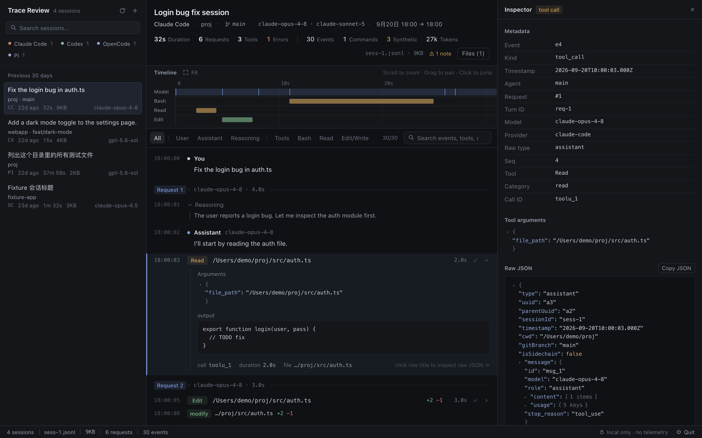

# Trace Review v0.0.11

## Trace Review 2.0 视觉层 —— A calm, native workspace for understanding agent execution

这一版只重构视觉层，不动业务。数据、交互、布局、API 都保持原样。目标是让它从 "Debug Console" 变成一款安静、专业、信息密度高但不拥挤的 macOS 原生开发者工具：Linear 的克制感、Raycast 的精致感、Xcode Instruments 的信息密度。

### 设计原则

- **颜色只表达含义**：蓝 = Model，琥珀 = 工具（Bash 等），绿 = Edit / Write，红 = 错误；其余都是灰阶
- **用排版代替效果**：靠字号、字重和间距区分层级。去掉渐变、玻璃效果、大圆角和装饰性阴影（只有浮层保留一层阴影）
- **Dark-first**：canvas `#0f1114` / surface `#14161a` / border `#262a31` / text `#e6e9ef` / muted `#9aa3b0` / accent `#7b9be0`
- **视觉优先级**：事件内容与执行路径 ＞ 时间定位与事件类型 ＞ 会话上下文 ＞ 统计信息 ＞ 装饰

### Design Tokens

- 原来近 1600 行的单个 `styles.css` 拆成 `web/src/styles/` 下 14 个文件，`styles.css` 只负责按顺序 `@import`
- `tokens.css` 是颜色、字号（SF Pro / SF Mono，11–13px）、圆角（4 / 6 / 8px）和控件高度的唯一来源
- 新增 `web/src/components/Icons.tsx`：统一 16px 网格的线性 SVG 图标，替换原来的字符图标（⟳ ✕ ⏻ ↗ ◆ ▸▾ 等）

### 各区域

- **Sidebar**：改成 Linear 式列表。provider 芯片去掉边框，只用色点区分；日期分组改为句首大写；live 会话的绿点放在标题末尾，标题左缘统一对齐
- **Header**：16px 标题加一行上下文（provider · 项目 · 分支 · 模型 · 时间范围）。指标栏分成主组（Duration / Requests / Tools / Errors）和次组（Events / Commands / Synthetic / Tokens），去掉全大写标签，0 值自动变暗
- **Timeline**：低饱和配色，轨道只画一条细线，没有填充。Model request 从实心大蓝条改为淡色带加起点刻度。新增 hover 竖线游标和带色块的 tooltip，刻度标签简化（`24h 0m` 改为 `24h`）
- **Filters**：15 个描边胶囊改成低对比紧凑工具栏，分组之间用细竖线隔开，只有选中项有底色
- **Event Stream**：不再用卡片，改为细分隔线、hover 底色和精确缩进。Request 边界改为左侧小标签加一条细线；Reasoning 用左侧竖线代替斜体；成功的工具调用只显示一个淡 ✓，hover 时变绿；连续工具调用的聚合行按工具类别着色
- **Inspector / Files**：标题层级统一，kind 标签使用语义色
- **状态栏**：macOS 风格，分隔线很细，右侧为 `local only · no telemetry` 和 Browser / Quit 按钮

### 窄窗口适配

打开 Inspector，或窗口只有 1280px 宽时：
- 滤镜栏先把搜索框缩到 180px，再让滤镜行横向滚动，右边缘淡出提示还有内容，计数不会再和芯片重叠
- 指标栏可以换行，换到下一行的组左边不会残留分隔线。文件名会先被省略，Files 按钮始终可见

### 验证

- `npm run typecheck`、44/44 测试、`npm run build` 全部通过
- E2E（`scripts/e2e-check.ts`）9/9 通过：会话库、打开 run、Timeline、滚动、Inspector、Raw JSON、User 过滤、搜索、无页面错误
- 视觉回归：新增 `scripts/visual-snapshot.ts`，对同一个 run 截取空状态 / 顶部 / 滚动 / 工具展开 + Inspector / Files 面板 / 搜索下拉 6 种状态，在 1568×980 和 1280×800 两种尺寸下与改版前逐张对比
- 测试和原生壳依赖的文本与 class 全部保留，例如 `.quit-btn` 仍由 Swift 壳负责隐藏
