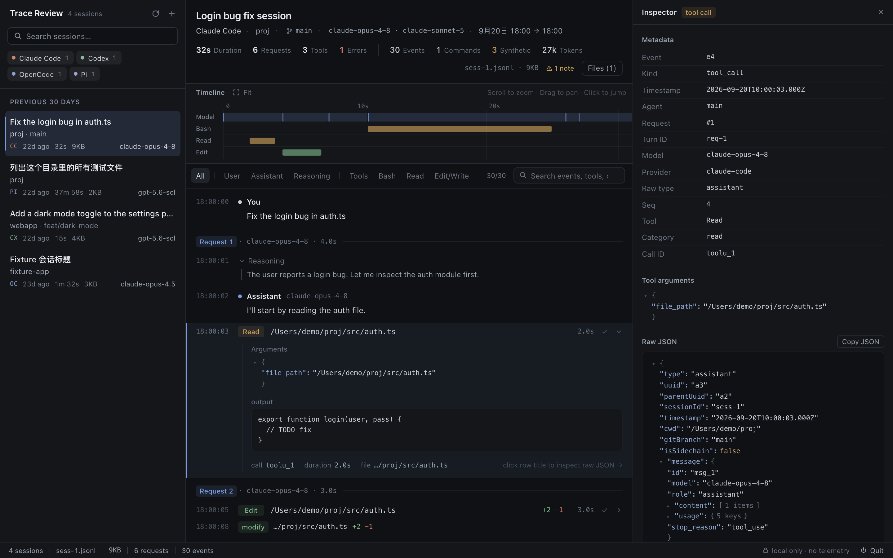

# Trace Review v0.0.12

## Sidebar 层级与对比度

v0.0.11 的左栏过于“高级灰”：搜索框、筛选标签、列表项都落在同一段灰度里，选中态压不住列表，标题、项目、元信息、模型名之间的对比差太小，长时间看会糊成一片。这一版仍然克制，方向是：**低饱和 + 更强层级 + 局部增强对比度**，该亮的地方亮，该弱的地方弱。只改左栏视觉，数据和交互不变。

### 三个区域分开处理

- **搜索框**：改为比侧栏更深的内嵌输入框，边框更清楚，高度 28px。placeholder 和放大镜图标提亮，聚焦时图标再亮一档
- **Provider 筛选**：改为带底色的胶囊，看起来就是开关，不再像列表文字。筛选时选中项抬起并描边，其余去掉底色、色点变暗
- **分组标题**（Today / Yesterday…）：改为小号大写、加字距，作为分节标记，和列表行明显区分

### 列表行：每行文字用不同的亮度档

| 行 | 颜色 | 对比度 |
|---|---|---|
| 标题 | `--text`，字重 500，13px | 14.9 : 1 |
| 项目 / 模型名 | `--muted` | 7.1 : 1 |
| 分支 / 统计 | 新增 `--meta` | 4.7 : 1（原来 3.8 : 1，低于 AA） |

- 项目和分支拆开：`envfactory · HEAD` 里的分支名再弱一档，扫列表时先看到项目
- Provider 缩写（CC / CX / OC / PI）沿用筛选芯片的色点颜色，作为一列安静的索引
- 模型名右对齐，比统计信息亮一档，单独成列

### 选中态

- 改为蓝色底 + 左侧 2px accent 竖条，和事件流选中行用同一套表现。选中行内每一行文字都提亮一档（标题 13.7 : 1）
- hover 底色减弱，和选中态明显区分

### 修复

- 元信息行的值不再换行：之前宽度紧张时 `just now`、`5h 41m` 会折成两行。现在只有模型名在空间不够时省略，悬停显示全部模型

### Design Tokens

`tokens.css` 新增 `--text-strong`、`--subtle`、`--meta`、`--selected`、`--field` / `--field-border`，以及 provider 身份色 `--p-*`（原来硬编码在 library.css 里）。

### 验证

- `npm run typecheck`、44/44 测试、`npm run build` 全部通过；E2E（`scripts/e2e-check.ts`）9/9 通过
- 左栏 2x 截图对比改版前后：空闲、选中 + hover、筛选 + 聚焦、搜索、多 provider 混排、窄侧栏（240px）压力测试
- 全局视觉回归（`scripts/visual-snapshot.ts`）1568×980 / 1280×800，左栏以外区域无变化
